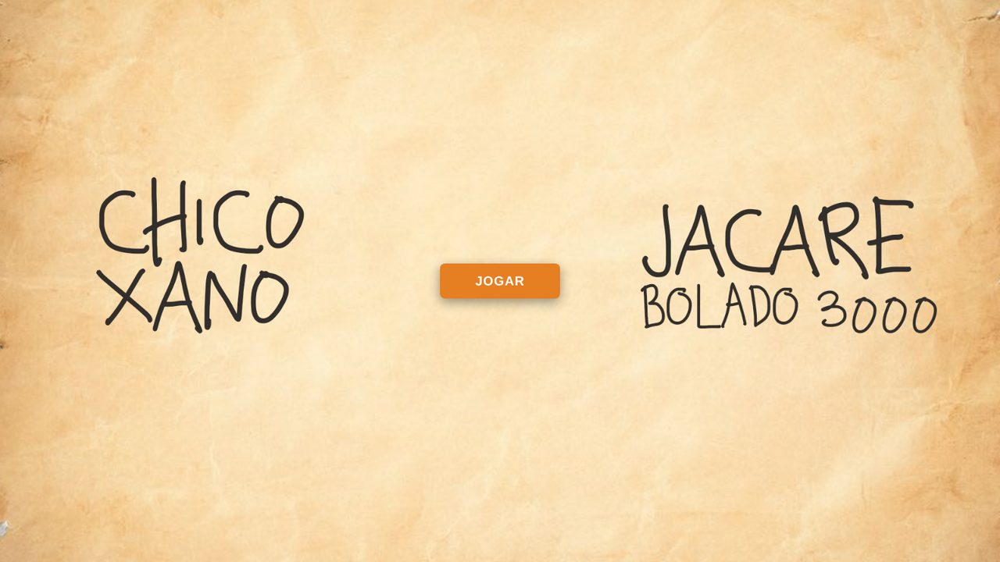
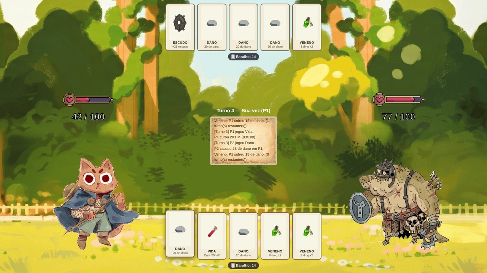
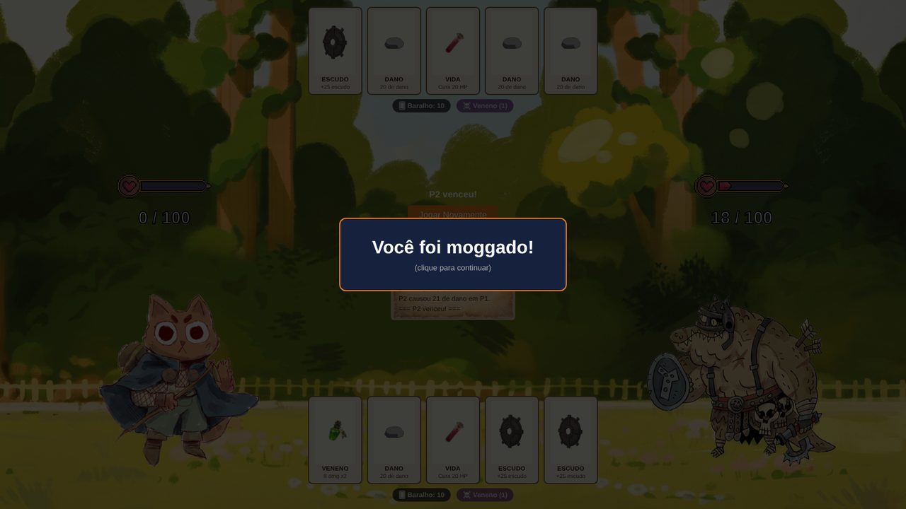

<h1 align="center">Chico Xano vs. Jacaré Bolado 3000</h1>

<p align="center">
  Jogo de cartas por turnos feito com HTML, CSS e JavaScript puro, direto no navegador.
</p>

<p align="center">
  <a href="https://matheusmpodev.github.io/jogo-cartas/front.html"><strong>▶ Jogar agora</strong></a>
</p>

<p align="center">
  
  
  
  
</p>

<p align="center">
  
</p>

## Sobre o jogo

Você controla o **Chico Xano**, um gato aventureiro, e enfrenta o **Jacaré Bolado 3000** em um duelo de cartas. A cada turno, você escolhe uma carta da sua mão para atacar, se curar ou se proteger. O jacaré responde em seguida. Vence quem zerar a vida do adversário primeiro.

O jogo foi desenvolvido em dupla como trabalho final da disciplina de **Lógica de Programação e Algoritmos** do curso de Análise e Desenvolvimento de Sistemas do **IFNMG – Campus Montes Claros**. Ele também foi apresentado às turmas escolares visitantes no Instituto de Portas Abertas (IPA) do campus.

## Como jogar

1. Clique em **Jogar** na tela inicial.
2. Cada jogador começa com **100 de vida** e **5 cartas** na mão.
3. Na sua vez, clique em uma carta para usá-la. Depois disso, você compra uma nova carta do baralho.
4. O Jacaré joga uma carta aleatória da mão dele.
5. A partida termina quando a vida de um dos dois chega a zero. Se as cartas dos dois acabarem, dá empate.

<p align="center">
  
</p>

## Cartas

Cada baralho tem 22 cartas, embaralhadas no início de toda partida.

| Carta | Quantidade | Efeito |
| --- | :---: | --- |
| **Dano** | 10 | Causa entre 15 e 30 de dano ao adversário. O valor varia a cada jogada. |
| **Vida** | 5 | Recupera 20 de vida, sem passar de 100. |
| **Escudo** | 4 | Dá 25 de escudo, que absorve dano antes da vida. |
| **Veneno** | 3 | Envenena o adversário, que perde 15 de vida no início dos próximos 2 turnos dele. |

O escudo se acumula e também absorve o dano do veneno.

<p align="center">
  
</p>

## Funcionalidades

- Baralho embaralhado com o algoritmo de Fisher-Yates.
- Barra de vida que muda de imagem conforme o personagem perde vida.
- Indicadores de baralho, escudo e veneno para cada jogador.
- Registro de jogadas que mostra tudo o que aconteceu em cada turno.
- Adversário controlado pelo computador.
- Tela de vitória, derrota ou empate, com opção de jogar novamente.

## Tecnologias

- **HTML5** para a estrutura da tela.
- **CSS3** para o layout com Flexbox, o fundo ilustrado e as animações dos botões.
- **JavaScript** puro, sem bibliotecas, para toda a lógica do jogo e a manipulação do DOM.
- **GitHub Pages** para a publicação.

## Como rodar localmente

```bash
git clone https://github.com/Matheusmpodev/jogo-cartas.git
cd jogo-cartas
```

Depois, abra o arquivo `front.html` no navegador.

## Estrutura do projeto

```
jogo-cartas/
├── front.html              # Estrutura da tela do jogo
├── front-stilização.css    # Estilos e layout
├── front.js                # Lógica do jogo
├── imagens/                # Cartas, personagens, barras de vida e fundos
└── screenshots/            # Imagens usadas neste README
```

## Desenvolvedores

| [<br>Matheus Pereira de Oliveira](https://github.com/Matheusmpodev) | [<br>Lucas Teixeira](https://github.com/lucasteixeiradevs) |
| :---: | :---: |

## Licença

Este projeto está sob a licença MIT. Veja o arquivo [LICENSE](LICENSE) para mais detalhes.
